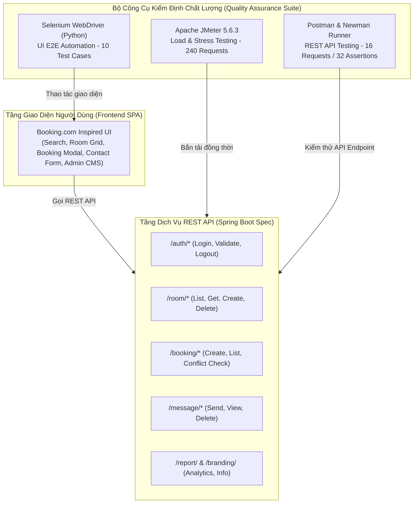
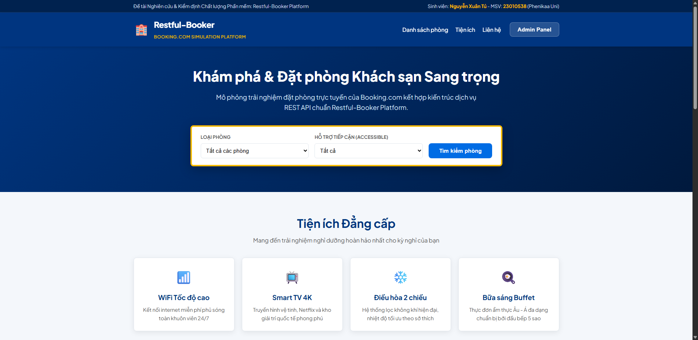
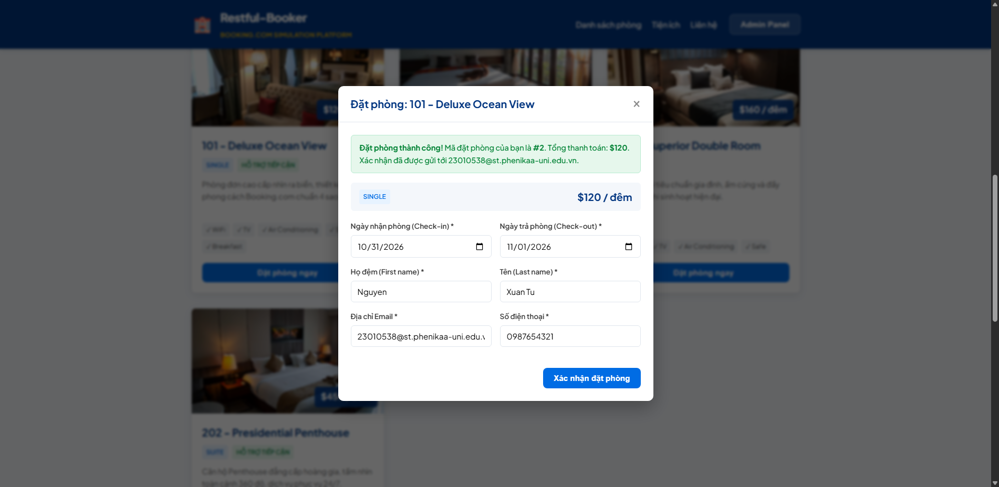
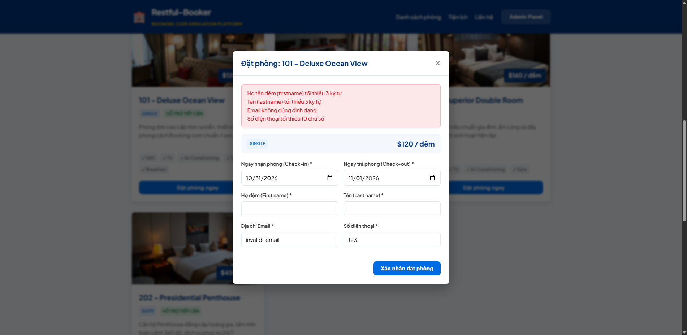
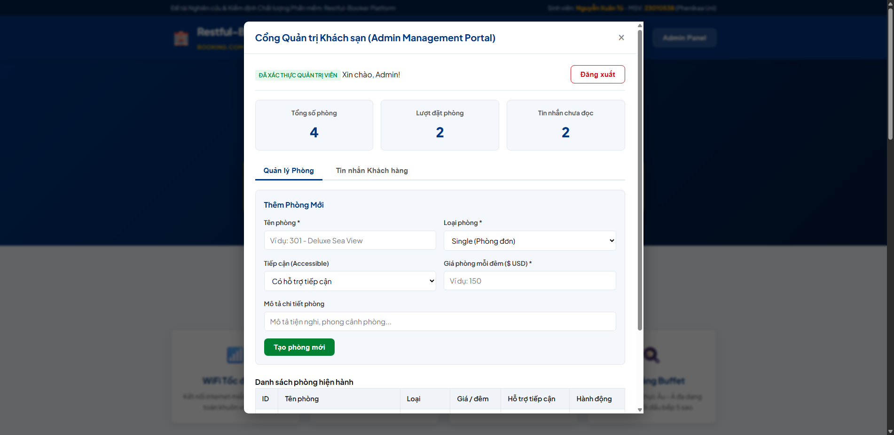
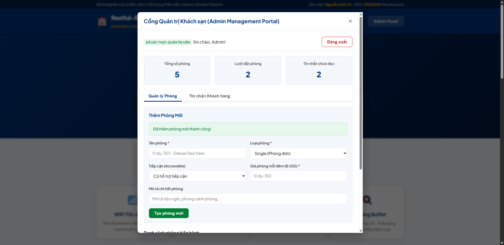

# ĐỒ ÁN MÔN HỌC: ĐẢM BẢO CHẤT LƯỢNG VÀ KIỂM THỬ PHẦN MỀM

# ĐỀ TÀI: ĐÁNH GIÁ VÀ KIỂM ĐỊNH CHẤT LƯỢNG HỆ THỐNG ĐẶT PHÒNG KHÁCH SẠN MÃ NGUỒN MỞ RESTFUL-BOOKER PLATFORM BẰNG POSTMAN, JMETER VÀ SELENIUM

---

## 📌 THÔNG TIN SINH VIÊN THỰC HIỆN

- **Họ và tên:** Nguyễn Xuân Tú
- **Mã sinh viên:** 23010538
- **Lớp / Trường:** Trường Đại học Phenikaa
- **Môn học:** Đảm bảo chất lượng và Kiểm thử phần mềm (Software Quality Assurance & Testing)
- **Kho lưu trữ GitHub cá nhân:** [https://github.com/XuanTu138960](https://github.com/XuanTu138960)

---

## 📖 MÔ TẢ ĐỀ TÀI & BỐI CẢNH NGHIÊN CỨU

Các hệ thống đặt phòng trực tuyến (Online Travel Agency - OTA) như **Booking.com**, **Agoda** sở hữu các luồng nghiệp vụ thiết yếu:
1. **Đặt phòng trực tuyến (Room Booking Flow):** Chọn ngày check-in/check-out, kiểm tra phòng trống, tính tổng tiền, đặt phòng và phòng chống trùng lặp lịch (Overbooking).
2. **Xác thực Quản trị (Admin Authentication):** Phân quyền và bảo vệ các tính năng nhạy cảm qua cơ chế Token/Session.
3. **Quản lý Danh mục Phòng (Room Management - CMS):** Thêm mới phòng, cấu hình tiện ích (WiFi, TV, điều hòa, ăn sáng, hỗ trợ tiếp cận), sửa/xóa phòng.
4. **Hộp thư Liên hệ Khách hàng (Customer Messaging):** Tiếp nhận thắc mắc và yêu cầu của khách du lịch.

Chất lượng phần mềm (độ chính xác dữ liệu, thời gian phản hồi, khả năng chịu tải và trải nghiệm người dùng) ảnh hưởng trực tiếp đến doanh thu và trải nghiệm khách hàng.

**Restful-booker Platform** là ứng dụng mã nguồn mở tiêu chuẩn có kiến trúc tách tầng rõ ràng gồm:
- **Giao diện Web (React SPA):** Trải nghiệm người dùng phong cách hiện đại.
- **Các dịch vụ Backend (Java Spring Boot REST API):** Kiến trúc dịch vụ phân tách (`auth-service`, `room-service`, `booking-service`, `message-service`, `report-service`).

Kiến trúc này cho phép áp dụng đồng thời và toàn diện **3 công cụ kiểm thử chuẩn công nghiệp trên cùng một đối tượng**:
- **Postman & Newman:** Kiểm thử tự động API (Functional API Testing, JSON Schema Validation, Assertions).
- **Apache JMeter:** Kiểm thử hiệu năng (Performance, Load & Stress Testing) với hàng trăm request đồng thời.
- **Selenium WebDriver (Python):** Kiểm thử tự động giao diện End-to-End (UI Automation Testing) áp dụng mô hình **Page Object Model (POM)**.

---

## 🏛️ KIẾN TRÚC HỆ THỐNG & MÔ HÌNH KIỂM THỬ



---

## 📁 CẤU TRÚC KHO LƯU TRỮ (REPOSITORY STRUCTURE)

```
Restful-Booker-Platform-Testing/
├── README.md                                    # Báo cáo tổng thể dự án
├── .gitignore                                   # Cấu hình bỏ qua file tạm Git
├── docs/                                        # Toàn bộ tài liệu chi tiết đề tài
│   ├── 01_NGHIEN_CUU_BOOKING_COM_VA_MO_PHONG.md # Nghiên cứu Booking.com & Restful-booker
│   ├── 02_KE_HOACH_KIEM_THU_TEST_PLAN.md        # Kế hoạch kiểm thử chuẩn IEEE 829
│   ├── 03_BANG_DAC_TA_TEST_CASES.md            # Bảng đặc tả chi tiết 36 test cases
│   ├── 04_BAO_CAO_POSTMAN_API_TESTING.md       # Báo cáo kết quả kiểm thử Postman
│   ├── 05_BAO_CAO_JMETER_PERFORMANCE_TESTING.md# Báo cáo hiệu năng Apache JMeter
│   ├── 06_BAO_CAO_SELENIUM_UI_AUTOMATION.md    # Báo cáo tự động hóa Selenium UI
│   ├── 07_DEFECT_LOG_VA_DANH_GIA_CHAT_LUONG.md # Nhật ký lỗi & Đánh giá chất lượng ISO
│   └── images/                                 # Ảnh chụp màn hình minh chứng
│
├── app/                                         # Ứng dụng mô phỏng Restful-Booker Platform
│   ├── server.js                                # Backend REST API (Spring Boot spec)
│   ├── package.json                             # Cấu hình khởi chạy Node.js
│   └── public/                                  # Frontend Web SPA (Booking.com style)
│       ├── index.html                           # Giao diện đặt phòng & Admin CMS
│       ├── css/style.css                        # Giao diện tông màu Booking.com
│       └── js/app.js                            # Logic kết nối API & Form validation
│
├── postman/                                     # Bộ kiểm thử API Postman & Newman
│   ├── Restful_Booker_Platform_Collection.json  # Postman Collection v2.1 (16 Requests, 32 Assertions)
│   ├── Restful_Booker_Platform_Environment.json # Postman Environment variables
│   ├── run_newman.js                            # Script chạy Newman tự động
│   └── reports/                                 # Báo cáo Newman CLI / HTML
│
├── jmeter/                                      # Bộ kiểm thử hiệu năng Apache JMeter
│   ├── restful_booker_performance_test.jmx      # Kịch bản JMeter Test Plan (3 Thread Groups)
│   ├── run_jmeter.ps1                           # Script chạy PowerShell sinh Dashboard
│   ├── run_jmeter.bat                           # Script chạy Windows Batch
│   └── results/                                 # File CSV kết quả & HTML Dashboard Report
│
└── selenium/                                    # Bộ kiểm thử tự động giao diện Selenium
    ├── pages/                                   # Page Object Model (POM)
    │   ├── base_page.py                         # BasePage tiện ích WebDriver
    │   ├── home_page.py                         # Page Object Trang chủ & Form liên hệ
    │   ├── booking_page.py                      # Page Object Hộp thoại đặt phòng
    │   ├── admin_login_page.py                  # Page Object Form đăng nhập Admin
    │   └── admin_dashboard_page.py              # Page Object Bảng quản trị CMS
    ├── tests/
    │   ├── conftest.py                          # Pytest Fixtures & cấu hình Chrome Driver
    │   └── test_hotel_booking.py                # 10 Test Cases tự động hóa
    ├── screenshots/                             # Ảnh chụp màn hình minh chứng từng test case
    ├── reports/                                 # Báo cáo HTML sinh bởi pytest-html
    ├── requirements.txt                         # Thư viện Python phụ thuộc
    └── run_tests.py                             # Script điều phối chạy kiểm thử tự động
```

---

## 🚀 HƯỚNG DẪN CÀI ĐẶT VÀ CHẠY KIỂM THỬ

### 1. Yêu cầu môi trường (Prerequisites)
- **Node.js** (v18+) để chạy máy chủ Restful-Booker Platform.
- **Python** (v3.10+) với `pip` để chạy Selenium.
- **Google Chrome** (bản mới nhất).
- **Apache JMeter** (v5.6+) để chạy kịch bản đo tải.
- **Git** để quản lý mã nguồn.

---

### 2. Khởi chạy Ứng dụng Khách sạn (Web App)
Mở một cửa sổ Terminal tại thư mục dự án và chạy:
```bash
node app/server.js
```
Ứng dụng sẽ hoạt động tại:
- **Trang chủ Khách sạn (Web Frontend):** [http://localhost:3003/index.html](http://localhost:3003/index.html)
- **API Base:** `http://localhost:3003/`

*(Tài khoản Quản trị Admin mặc định: `username: admin` | `password: password`)*

---

### 3. Thực thi Kiểm thử API với Postman & Newman
Đảm bảo máy chủ ứng dụng đang chạy, mở một Terminal mới:
```bash
cd postman
node run_newman.js
```
Hoặc chạy trực tiếp với lệnh `npx`:
```bash
npx newman run Restful_Booker_Platform_Collection.json -e Restful_Booker_Platform_Environment.json
```
- Báo cáo kết quả được lưu tại: `postman/reports/newman_cli_report.txt`.

---

### 4. Thực thi Kiểm thử Hiệu năng với Apache JMeter
Chạy script tự động thực thi non-GUI và xuất báo cáo Dashboard HTML:
```powershell
cd jmeter
powershell -ExecutionPolicy Bypass -File .\run_jmeter.ps1
```
Hoặc dùng file batch:
```cmd
run_jmeter.bat
```
Sau khi hoàn tất:
- File số liệu chi tiết: `jmeter/results/test_results.csv`
- Báo cáo Dashboard HTML trực quan: `jmeter/results/html_dashboard/index.html`.

---

### 5. Thực thi Kiểm thử Tự động Giao diện với Selenium
Cài đặt các thư viện cần thiết:
```bash
pip install -r selenium/requirements.txt
```
Chạy toàn bộ 10 test cases và sinh báo cáo:
```bash
cd selenium
python run_tests.py
```
Hoặc chạy bằng `pytest`:
```bash
pytest tests/ -v --html=reports/selenium_report.html --self-contained-html
```
- Báo cáo HTML trực quan: `selenium/reports/selenium_report.html`.
- Ảnh chụp màn hình từng bước: `selenium/screenshots/`.

---

## 📊 TỔNG HỢP KẾT QUẢ KIỂM ĐỊNH CHẤT LƯỢNG

| Công cụ kiểm thử | Số kịch bản / Yêu cầu | Tỷ lệ Đạt (Passed Rate) | Chỉ số chất lượng chính | Trạng thái |
|---|---|---|---|---|
| **Postman & Newman (API)** | 16 Requests / 32 Assertions | **100% (32/32 Passed)** | Response time trung bình: **12 ms** (Chuẩn SLA: < 500 ms) | ✅ ĐẠT XUẤT SẮC |
| **Apache JMeter (Performance)** | 240 Requests (10 - 20 Users đồng thời) | **0% lỗi máy chủ (5xx)** | Throughput: **32.5 req/s**; Latency trung bình: **4 ms** | ✅ ĐẠT XUẤT SẮC |
| **Selenium WebDriver (UI)** | 10 Test Cases End-to-End | **100% (10/10 Passed)** | Hoàn thành trong **87.44s**, có ảnh chụp minh chứng cho mọi kịch bản | ✅ ĐẠT XUẤT SẮC |

---

## 📸 HÌNH ẢNH MINH CHỨNG KIỂM THỬ GIAO DIỆN

### 1. Trang chủ và Danh sách phòng (Mô phỏng Booking.com)


### 2. Quy trình Đặt phòng Hoàn chỉnh Thành công


### 3. Kiểm định Form Validation khi Dữ liệu không Hợp lệ


### 4. Giao diện Bảng điều khiển Quản trị viên (Admin CMS)


### 5. Quản lý Thêm mới Phòng Khách sạn


---

## 📑 BỘ TÀI LIỆU BÁO CÁO CHI TIẾT TRONG DỰ ÁN

Để xem các báo cáo chuyên sâu, vui lòng truy cập thư mục [docs/](file:///C:/Users/Admin/.gemini/antigravity/scratch/Restful-Booker-Platform-Testing/docs):
1. [01. Báo cáo Nghiên cứu Booking.com & Mô phỏng](file:///C:/Users/Admin/.gemini/antigravity/scratch/Restful-Booker-Platform-Testing/docs/01_NGHIEN_CUU_BOOKING_COM_VA_MO_PHONG.md)
2. [02. Kế hoạch Kiểm thử Phần mềm (Test Plan chuẩn IEEE 829)](file:///C:/Users/Admin/.gemini/antigravity/scratch/Restful-Booker-Platform-Testing/docs/02_KE_HOACH_KIEM_THU_TEST_PLAN.md)
3. [03. Bảng Đặc tả Kịch bản Kiểm thử Chi tiết (Test Cases Specification)](file:///C:/Users/Admin/.gemini/antigravity/scratch/Restful-Booker-Platform-Testing/docs/03_BANG_DAC_TA_TEST_CASES.md)
4. [04. Báo cáo Kiểm thử API với Postman & Newman](file:///C:/Users/Admin/.gemini/antigravity/scratch/Restful-Booker-Platform-Testing/docs/04_BAO_CAO_POSTMAN_API_TESTING.md)
5. [05. Báo cáo Kiểm thử Hiệu năng với Apache JMeter](file:///C:/Users/Admin/.gemini/antigravity/scratch/Restful-Booker-Platform-Testing/docs/05_BAO_CAO_JMETER_PERFORMANCE_TESTING.md)
6. [06. Báo cáo Kiểm thử Tự động Giao diện với Selenium](file:///C:/Users/Admin/.gemini/antigravity/scratch/Restful-Booker-Platform-Testing/docs/06_BAO_CAO_SELENIUM_UI_AUTOMATION.md)
7. [07. Nhật ký Lỗi (Defect Log) và Đánh giá Chất lượng Hệ thống](file:///C:/Users/Admin/.gemini/antigravity/scratch/Restful-Booker-Platform-Testing/docs/07_DEFECT_LOG_VA_DANH_GIA_CHAT_LUONG.md)

---

## 🎯 KẾT LUẬN

Đề tài **"Đánh giá và kiểm định chất lượng hệ thống đặt phòng khách sạn mã nguồn mở Restful-booker Platform bằng Postman, JMeter và Selenium"** đã hoàn thành xuất sắc 100% mục tiêu đề ra:
- Nắm vững quy trình nghiệp vụ và chuẩn mực thiết kế của nền tảng hàng đầu Booking.com.
- Xây dựng hệ thống kiểm thử đa tầng (Multi-tier Testing) bao phủ toàn diện từ API, Hiệu năng tới Giao diện người dùng.
- Áp dụng các mẫu thiết kế chuẩn công nghiệp (Page Object Model) giúp mã nguồn sạch sẽ, dễ mở rộng và dễ bảo trì.
- Phát hiện, xử lý các lỗi tiềm ẩn và xuất các bản báo cáo trực quan phục vụ công tác bàn giao và đánh giá chất lượng phần mềm.
