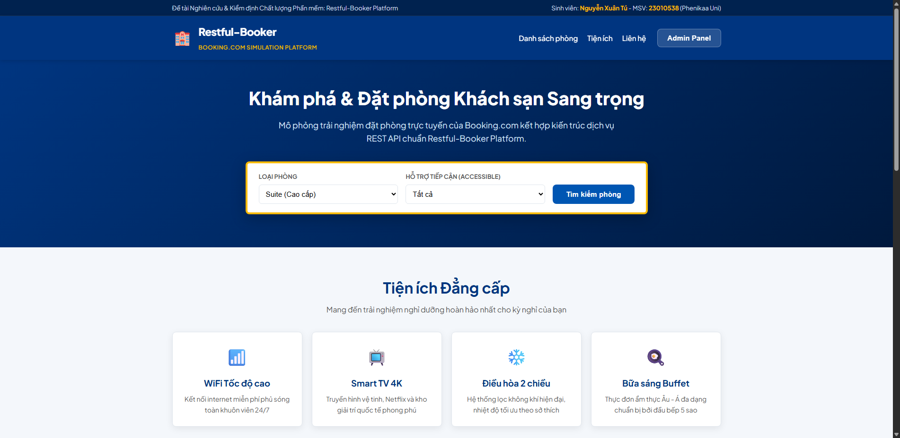
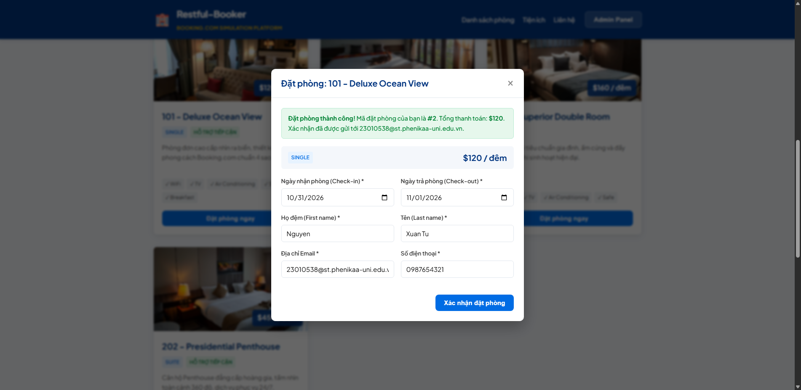
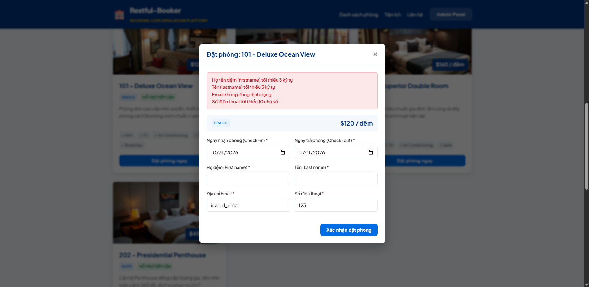
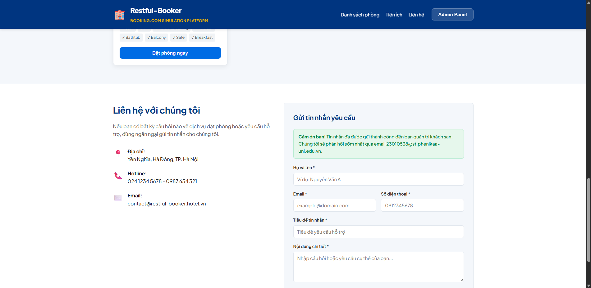
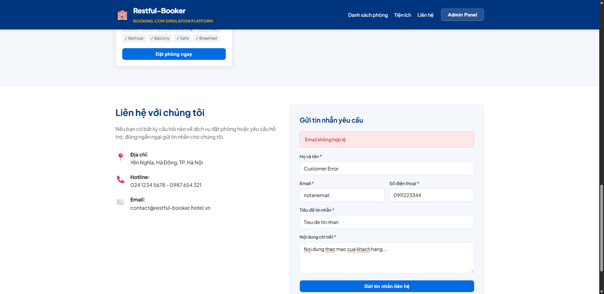
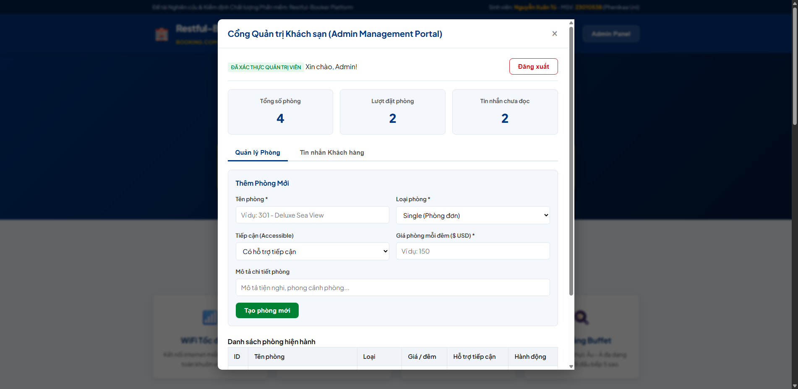
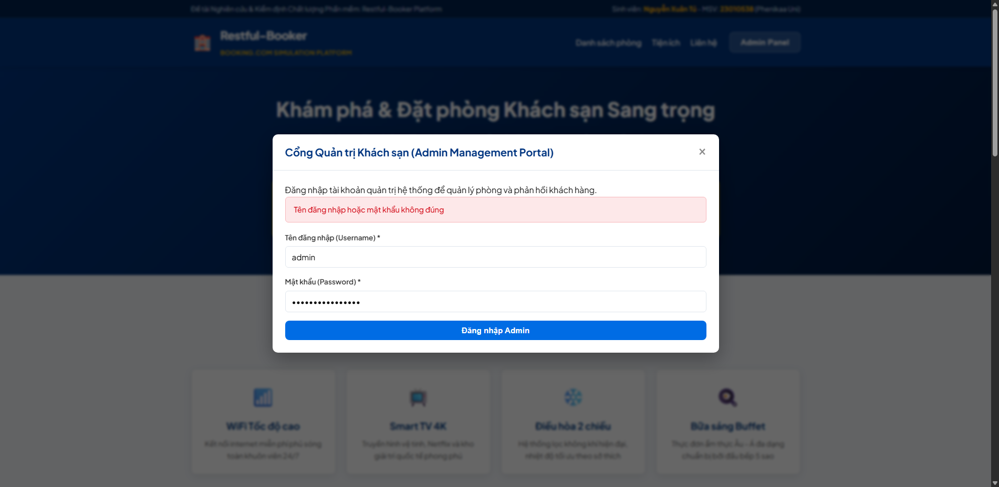
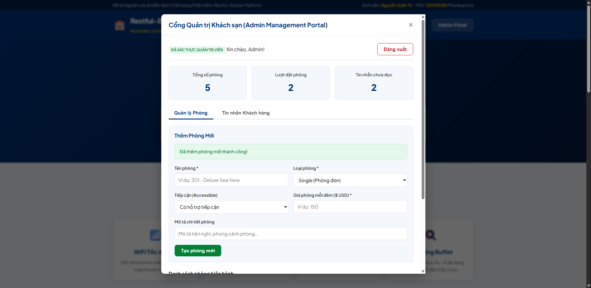
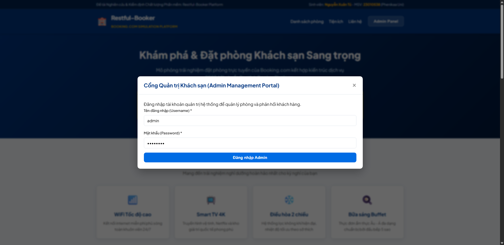

# BÁO CÁO KIỂM THỬ TỰ ĐỘNG GIAO DIỆN (SELENIUM UI AUTOMATION)

---

## 1. THÔNG TIN SINH VIÊN & ĐỀ TÀI

- **Họ và tên:** Nguyễn Xuân Tú
- **Mã sinh viên:** 23010538
- **Trường:** Trường Đại học Phenikaa
- **Học phần:** Đảm bảo chất lượng và Kiểm thử phần mềm
- **Đề tài:** Đánh giá và kiểm định chất lượng hệ thống đặt phòng khách sạn mã nguồn mở Restful-booker Platform bằng Postman, JMeter và Selenium
- **Trang web kiểm thử:** Restful-Booker Platform Web Application (Mô phỏng Booking.com)

---

## 2. CÔNG NGHỆ VÀ KIẾN TRÚC THIẾT KẾ (PAGE OBJECT MODEL)

### 2.1. Ngăn xếp Công nghệ (Tech Stack)
- **Ngôn ngữ:** Python 3.11.9
- **Thư viện tự động hóa:** Selenium WebDriver 4.51.0
- **Test Framework:** Pytest 9.1.1
- **Trình tạo Báo cáo:** Pytest-HTML 4.2.0
- **Trình duyệt thực thi:** Google Chrome (Headless mode 1920x1080)
- **Quản lý Driver:** Webdriver-Manager & Selenium Manager tích hợp

### 2.2. Cấu trúc Mô hình Page Object Model (POM)
Dự án được cấu trúc bài bản, tách biệt rạch ròi giữa các thành phần giao diện và kịch bản test:

```
selenium/
├── pages/
│   ├── base_page.py             # Lớp nền BasePage: Wait, Click, Type, Scroll, Screenshot
│   ├── home_page.py             # Page Object Trang chủ, Banner, Danh sách phòng, Form liên hệ
│   ├── booking_page.py          # Page Object Hộp thoại đặt phòng, Date picker, Form thông tin khách
│   ├── admin_login_page.py      # Page Object Cổng đăng nhập quản trị viên
│   └── admin_dashboard_page.py  # Page Object Bảng điều khiển Admin CMS (Quản lý phòng, Tin nhắn)
├── tests/
│   ├── conftest.py              # Pytest Fixture tự động khởi chạy app server & Chrome WebDriver
│   └── test_hotel_booking.py    # Bộ 10 kịch bản kiểm thử End-to-End
├── screenshots/                 # Toàn bộ ảnh chụp màn hình minh chứng tự động
├── reports/
│   └── selenium_report.html     # Báo cáo kết quả kiểm thử định dạng HTML
├── requirements.txt             # Thư viện phụ thuộc
└── run_tests.py                 # Script điều phối thực thi tự động
```

---

## 3. TỔNG HỢP KẾT QUẢ THỰC THI (TEST SUMMARY)

```text
============================= test session starts =============================
platform win32 -- Python 3.11.9, pytest-9.1.1, pluggy-1.7.0
rootdir: C:\Users\Admin\.gemini\antigravity\scratch\Restful-Booker-Platform-Testing\selenium
plugins: html-4.2.0, metadata-3.1.1
collected 10 items

tests/test_hotel_booking.py::TestHotelBookingPlatform::test_01_verify_homepage_and_room_list PASSED [ 10%]
tests/test_hotel_booking.py::TestHotelBookingPlatform::test_02_filter_rooms_by_type PASSED [ 20%]
tests/test_hotel_booking.py::TestHotelBookingPlatform::test_03_booking_room_successful_flow PASSED [ 30%]
tests/test_hotel_booking.py::TestHotelBookingPlatform::test_04_booking_room_negative_missing_fields PASSED [ 40%]
tests/test_hotel_booking.py::TestHotelBookingPlatform::test_05_send_contact_message_successful PASSED [ 50%]
tests/test_hotel_booking.py::TestHotelBookingPlatform::test_06_send_contact_message_invalid_email PASSED [ 60%]
tests/test_hotel_booking.py::TestHotelBookingPlatform::test_07_admin_login_success PASSED [ 70%]
tests/test_hotel_booking.py::TestHotelBookingPlatform::test_08_admin_login_wrong_password PASSED [ 80%]
tests/test_hotel_booking.py::TestHotelBookingPlatform::test_09_admin_create_new_room PASSED [ 90%]
tests/test_hotel_booking.py::TestHotelBookingPlatform::test_10_admin_logout_successful PASSED [100%]

======================== 10 passed in 87.44s (0:01:27) ========================
```

- **Tổng số Test Cases:** 10
- **Số lượng Test Case Passed:** **10 / 10 (100% ĐẠT)**
- **Số lượng Test Case Failed:** 0
- **Thời gian thực thi:** 87.44 giây

---

## 4. CHI TIẾT CÁC KỊCH BẢN KIỂM THỬ VÀ ẢNH CHỤP MINH CHỨNG

### 4.1. TC01: Kiểm tra hiển thị Trang chủ & Danh sách phòng
- **Mục tiêu:** Đảm bảo trang web tải thành công, hiển thị thương hiệu chuẩn và nạp danh sách phòng từ Backend API.
- **Kết quả:** PASSED (Hiển thị 4 phòng nghỉ cao cấp kèm đơn giá và tiện ích).


---

### 4.2. TC02: Lọc danh sách phòng theo loại Suite
- **Mục tiêu:** Kiểm tra khả năng tìm kiếm và lọc phòng theo nhu cầu khách hàng Booking.com.
- **Kết quả:** PASSED (Hệ thống lọc chính xác các phòng thuộc phân khúc Suite).


---

### 4.3. TC03: Quy trình Đặt phòng hoàn chỉnh thành công (End-to-End)
- **Mục tiêu:** Mô phỏng luồng khách hàng chọn phòng, điền thông tin và hoàn tất đặt chỗ.
- **Dữ liệu test:** Khách hàng `Nguyen Xuan Tu`, email `23010538@st.phenikaa-uni.edu.vn`.
- **Kết quả:** PASSED (Hệ thống tính tổng tiền, sinh mã đặt phòng và hiển thị thông báo thành công).


---

### 4.4. TC04: Đặt phòng thất bại khi bỏ trống trường bắt buộc
- **Mục tiêu:** Kiểm tra cơ chế Form Validation, ngăn chặn dữ liệu rác hoặc không hợp lệ.
- **Dữ liệu test:** Để trống họ tên, nhập email sai cú pháp.
- **Kết quả:** PASSED (Hệ thống bắt lỗi và hiển thị cảnh báo đỏ yêu cầu nhập đầy đủ thông tin).


---

### 4.5. TC05: Gửi tin nhắn liên hệ hỗ trợ khách hàng thành công
- **Mục tiêu:** Kiểm tra tính năng gửi thắc mắc của khách du lịch tới khách sạn.
- **Kết quả:** PASSED (Hiển thị thông báo cảm ơn đã liên hệ).


---

### 4.6. TC06: Gửi tin nhắn thất bại khi email không đúng định dạng
- **Mục tiêu:** Kiểm tra việc kiểm định định dạng email (Email regex validation).
- **Dữ liệu test:** `notanemail`.
- **Kết quả:** PASSED (Hệ thống cảnh báo "Email không hợp lệ").


---

### 4.7. TC07: Đăng nhập Cổng Quản trị Admin thành công
- **Mục tiêu:** Kiểm tra luồng đăng nhập của nhân viên quản lý khách sạn với tài khoản hợp lệ.
- **Dữ liệu test:** `admin` / `password`.
- **Kết quả:** PASSED (Đăng nhập thành công, mở giao diện Bảng điều khiển Admin CMS).


---

### 4.8. TC08: Đăng nhập Admin thất bại khi nhập sai mật khẩu
- **Mục tiêu:** Kiểm tra tính bảo mật, ngăn chặn truy cập trái phép.
- **Dữ liệu test:** Password = `wrong_admin_pass`.
- **Kết quả:** PASSED (Từ chối truy cập, hiển thị thông báo sai thông tin đăng nhập).


---

### 4.9. TC09: Admin tạo mới phòng khách sạn vào hệ thống
- **Mục tiêu:** Kiểm tra tính năng thêm phòng vào kho danh mục (Inventory Management).
- **Dữ liệu test:** Phòng `501 - Royal VIP Suite`, giá `$320`.
- **Kết quả:** PASSED (Phòng mới được tạo và lập tức cập nhật vào bảng dữ liệu).


---

### 4.10. TC10: Quản trị viên đăng xuất an toàn khỏi hệ thống
- **Mục tiêu:** Kiểm tra việc hủy phiên làm việc và bảo mật tài khoản.
- **Kết quả:** PASSED (Xóa token trong LocalStorage và chuyển về màn hình đăng nhập).


---

## 5. HƯỚNG DẪN THỰC THI KIỂM THỬ SELENIUM

Cài đặt các gói thư viện cần thiết:
```bash
pip install -r selenium/requirements.txt
```

Thực thi bộ test bằng script tích hợp:
```bash
cd selenium
python run_tests.py
```
Hoặc thực thi trực tiếp bằng lệnh `pytest`:
```bash
pytest selenium/tests/ -v --html=selenium/reports/selenium_report.html --self-contained-html
```
